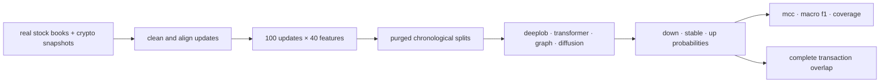
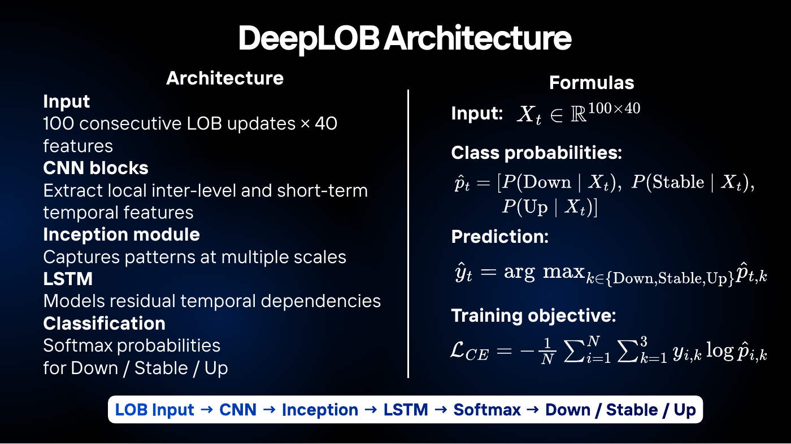
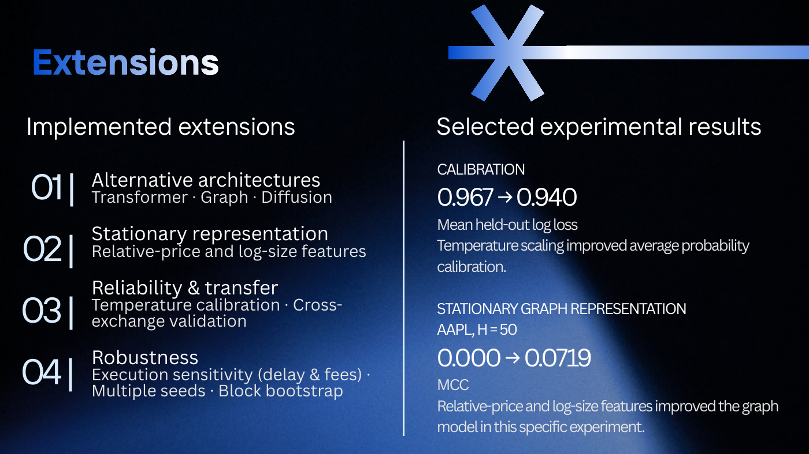

<div align="center">

# lob forecasting lab

**deep limit order book forecasting · reproduction and extensions**

[notebook](lob_reproduction_future_work.ipynb) · [presentation](docs/presentation.pdf) · [slide gallery](docs/presentation.md) · [interactive dashboard](https://khaamr.github.io/lob-forecasting-lab/)

**7 order books &nbsp; / &nbsp; 4 neural architectures &nbsp; / &nbsp; 3 horizons &nbsp; / &nbsp; 27 interactive views**

[](docs/presentation.pdf)

</div>

can a model predict the next price move and still produce a poor trading signal? this study follows a limit order book from raw updates to directional forecasts, then evaluates the timing of complete predicted transactions.

based on **briola, bartolucci and aste (2025), _deep limit order book forecasting: a microstructural guide_**. [read the article](https://doi.org/10.1080/14697688.2025.2522911) · [authors' lobframe code](https://github.com/FinancialComputingUCL/LOBFrame)

> **research scope:** this is a public-data method reproduction and extension. the original licensed 15-stock, 2017–2019 panel is unavailable. the saved experiments use different dates, a smaller training budget and short contiguous evaluation windows. they do not reproduce the paper's numerical benchmark.

## explore the study

| start here | what you will find |
| --- | --- |
| [executed notebook](lob_reproduction_future_work.ipynb) | visible model implementations, data lineage, experiments, tables and plotly graphs |
| [18-slide presentation](docs/presentation.pdf) | the motivation, paper framework, architecture, findings and limitations |
| [interactive dashboard](https://khaamr.github.io/lob-forecasting-lab/) | an interactive gallery of all 27 views; [download the offline html](research_dashboard.html) |
| [reproduction guide](docs/reproduction.md) | environment setup, data acquisition, cached replay and retraining |
| [saved results](results) | metrics, calibration, transfer, ablations, uncertainty and verification records |

## from book updates to decisions



we retain ten price/size levels on each side of the book. a 100-update historical window predicts the mid-price direction after **10, 50 or 100 book updates**. horizons count events, rather than seconds. chronological boundaries purge overlapping inputs and future labels, and normalization uses training observations only.

<details>
<summary><strong>the deeplob benchmark architecture</strong></summary>



three convolution blocks extract spatial and temporal patterns, inception branches combine scales, and an lstm maps the sequence to three class probabilities. transformer, graph/gru and conditional diffusion alternatives are independently implemented alongside prior, persistence and logistic baselines.

</details>

## what the saved experiments show

means below give equal weight to the **21 asset/horizon combinations** across five stock books and two crypto snapshot samples, at confidence threshold **0.3**. higher mcc, macro f1 and transaction overlap are better. undefined transaction overlaps are omitted from that column's mean.

| model | mean mcc | macro f1 | transaction overlap |
| --- | ---: | ---: | ---: |
| logistic | **0.1191** | 0.3151 | 0.0181 |
| persistence | 0.0909 | **0.4029** | **0.0675** |
| transformer | 0.0766 | 0.2747 | 0.0093 |
| deeplob | 0.0160 | 0.2325 | 0.0055 |
| graph + gru | 0.0035 | 0.2099 | 0.0021 |
| conditional diffusion | 0.0014 | 0.2006 | 0.0047 |
| class prior | 0.0000 | 0.2517 | 0.0000 |

the logistic baseline has the highest average mcc, while persistence has the highest transaction overlap. the saved study therefore supports evaluating classification and signal timing separately. these averages do not establish general superiority of an architecture.

transaction overlap compares complete directional sequences derived from predicted and true labels. it is **not a fill probability or a profitability measure**. the first 4,096 eligible test windows span approximately **12 seconds to 13 minutes**, depending on the book. the original paper's full-day results are a separate reference.

[data behind the table](results/metrics.csv) · [exact evaluation intervals](results/evaluation_windows.csv) · [microstructure audit](results/microstructure.csv)

## extensions beyond the benchmark

| extension | question it investigates |
| --- | --- |
| relative prices and log sizes | does a more stationary representation help the graph model? |
| graph-edge ablation | do the connections add information beyond the same node features? |
| temperature calibration | are predicted probabilities reliable on held-out observations? |
| cross-exchange transfer | can a model transfer between real binance and coinbase snapshots? |
| fee and delay sensitivity | how sensitive are assumed execution outcomes to friction and timing? |
| seeds, bootstrap and training budget | how stable are results to sampling uncertainty and compute? |
| daily forecasting | do separate daily-bar models generalize across 2024 and 2025? |



daily bars form a separate experiment and are never substituted for order books. the licensed-archive adapter is supplied but has not been run against the unavailable original dataset. [full protocol and limitations](docs/reproduction.md)

## reproduce

use **python 3.10**. requirements.txt and requirements.lock record the publication validation runtime. the supplied run environment is preserved in environment/archived-requirements.txt; exact numerical replay can depend on package and platform versions.

```sh
git clone https://github.com/khaamr/lob-forecasting-lab.git
cd lob-forecasting-lab
python3.10 -m venv .venv
source .venv/bin/activate
python -m pip install -r requirements.txt
python -m ipykernel install --user --name lob-research --display-name 'lob research'
python -m pytest -q tests
```

open the notebook with the `lob research` kernel. its first data cell downloads missing public inputs. the repository includes saved model outputs, checkpoints and the executed notebook; raw vendor data must be acquired separately. the downloader writes hashes, which are checked before the data are used.

for the command-line pipeline and full retraining, see the [reproduction guide](docs/reproduction.md). to review without downloading data or training, open the [presentation](docs/presentation.pdf), notebook outputs or [offline dashboard](research_dashboard.html).

## data and provenance

- **stock books:** official lobster public samples for aapl, amzn, goog, intc and msft on **2012-06-21**; ten levels and matching messages.
- **crypto books:** the first 60,000 captured binance and coinbase bitcoin snapshots on **2024-01-01**; ten levels retained.
- **daily extension:** adjusted stock/qqq daily bars during **2022–2025**, kept separate from the event-level task.

[archived source manifests](data/manifests) · [official lobster samples](https://php.lobsterdata.com/info/DataSamples.php) · [tardis sample documentation](https://docs.tardis.dev/downloadable-csv-files/overview) · [upstream revision](results/reference_revision.json)

vendor inputs and the third-party reference checkout are excluded from this repository. the original article is linked above; the presentation is included as supplied by the team.

## team 8

**olga makogonova · amira khabibullina · victoria ostrovskaya · vladislav alov · alexander pokrovsky**

presentation, public-data reproduction and research extensions. the original paper and lobframe framework are credited to their respective authors.
