# team 8 presentation

[open the original 18-slide pdf](presentation.pdf) · [return to the project](../README.md)

slide previews are rendered directly from the supplied presentation. select an image for its full-size preview.

## 01. deep limit order book forecasting:

[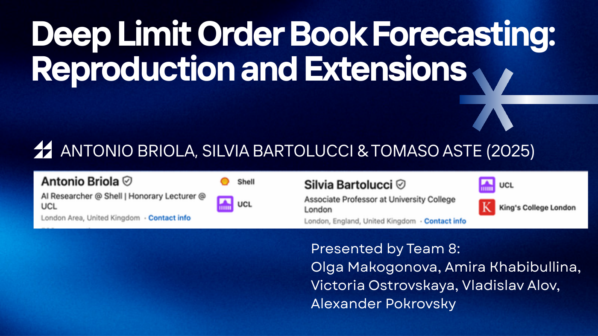](slides/slide-01.png)

## 02. problem & motivation

[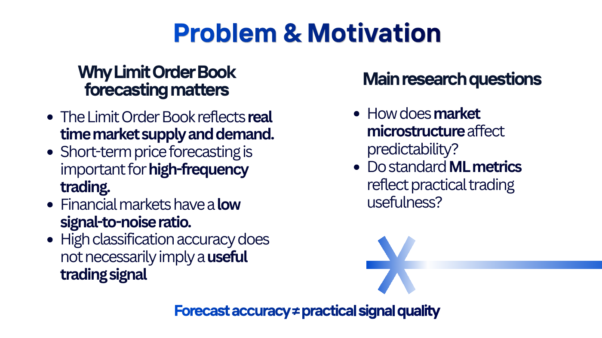](slides/slide-02.png)

## 03. research relevance

[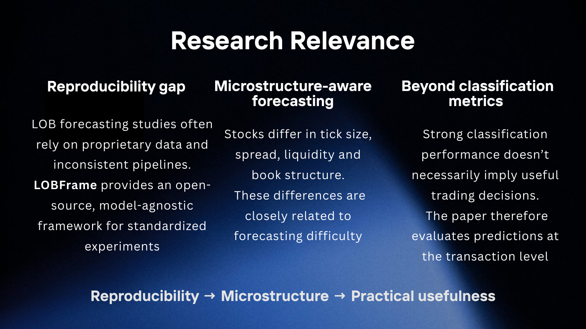](slides/slide-03.png)

## 04. paper framework

[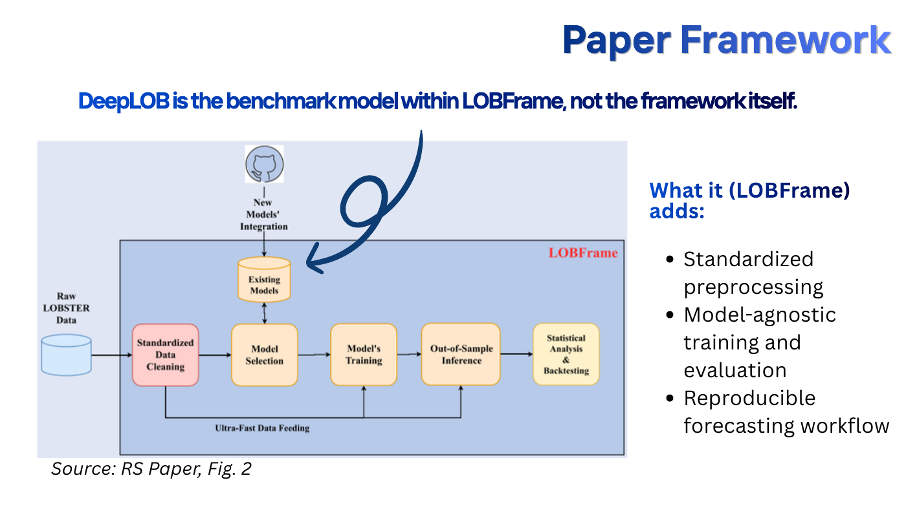](slides/slide-04.png)

## 05. limit order book representation

[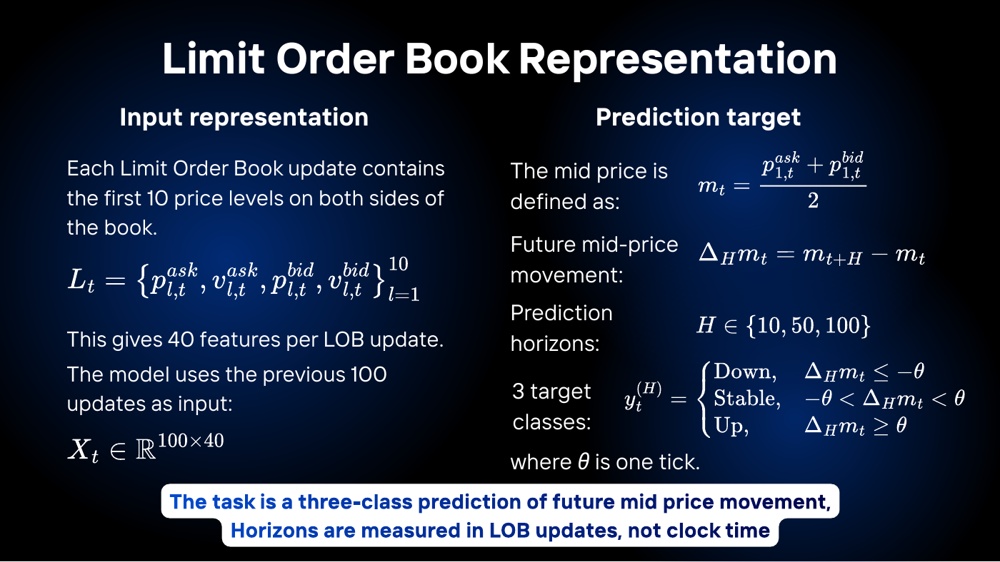](slides/slide-05.png)

## 06. deeplob architecture

[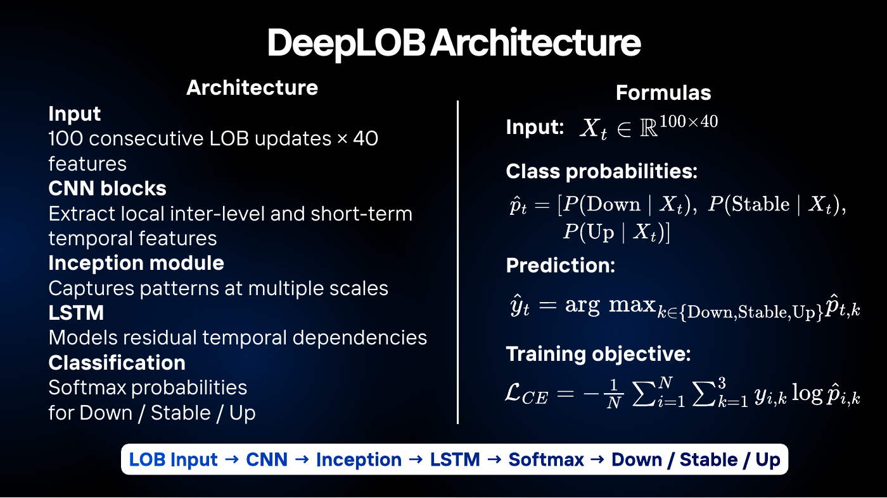](slides/slide-06.png)

## 07. evaluation metrics

[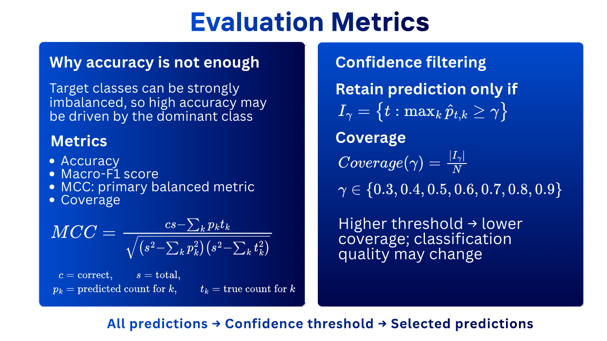](slides/slide-07.png)

## 08. transaction-level evaluation

[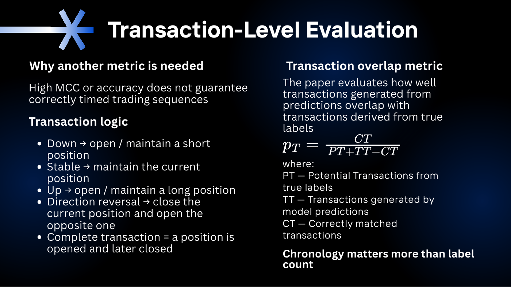](slides/slide-08.png)

## 09. our reproduction

[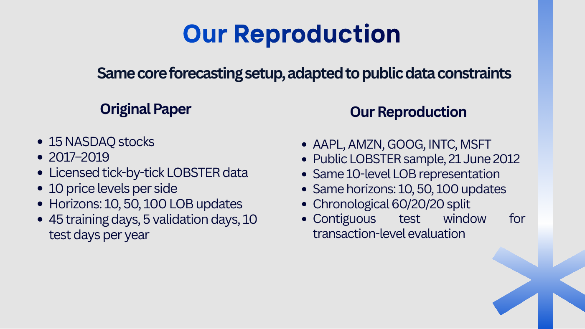](slides/slide-09.png)

## 10. preprocessing and leakage control

[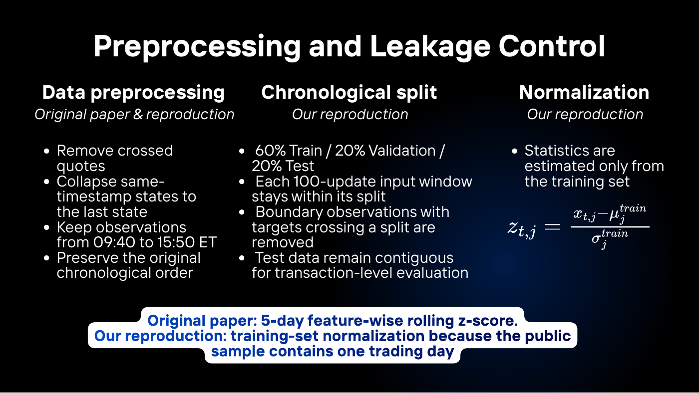](slides/slide-10.png)

## 11. original paper results                                            transaction-level results

[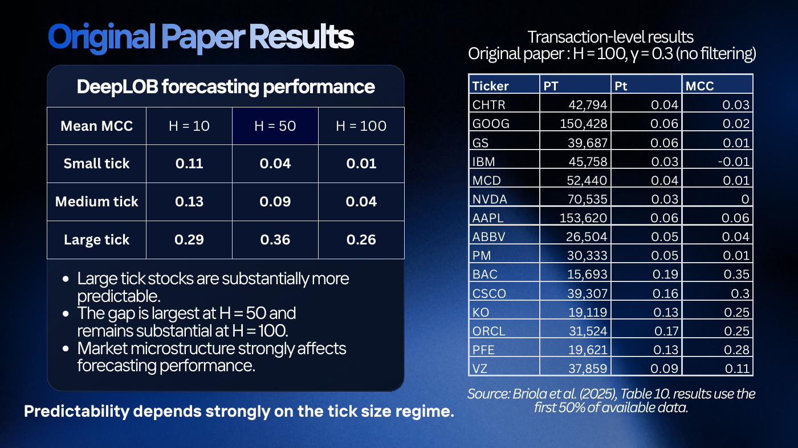](slides/slide-11.png)

## 12. our reproduced results

[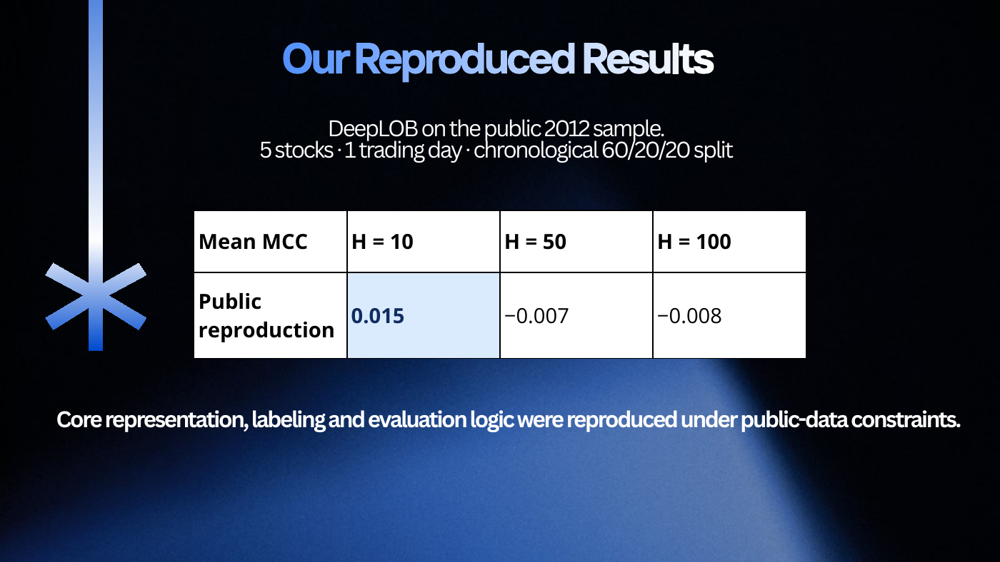](slides/slide-12.png)

## 13. paper vs reproduction

[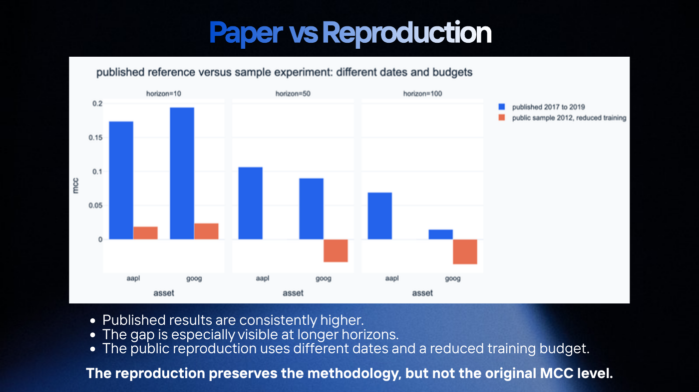](slides/slide-13.png)

## 14. model comparison on held-out data

[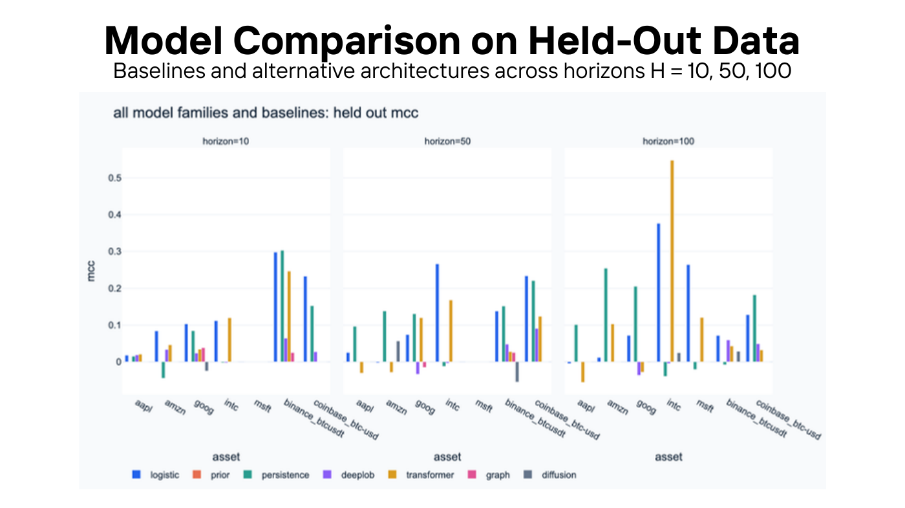](slides/slide-14.png)

## 15. model performance vs transaction quality

[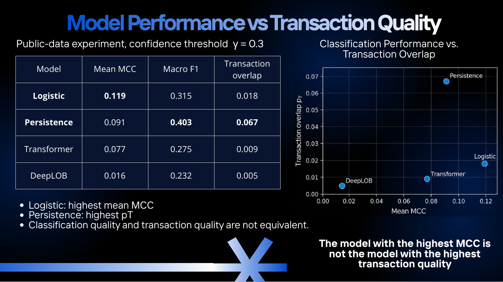](slides/slide-15.png)

## 16. extensions

[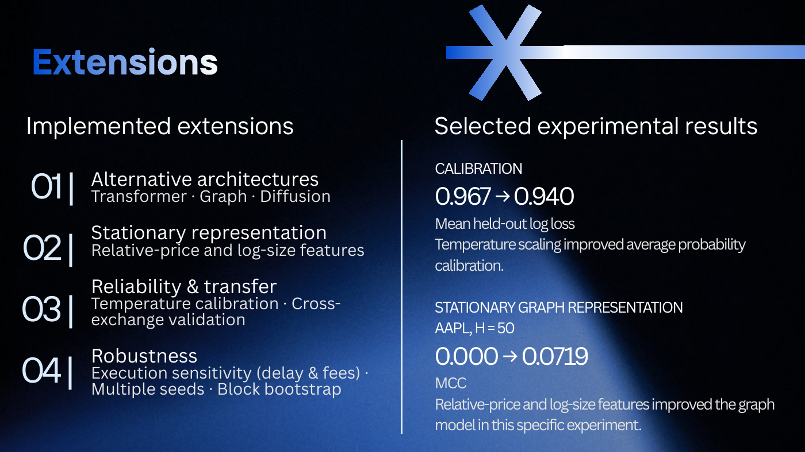](slides/slide-16.png)

## 17. limitations:                          main conclusions:

[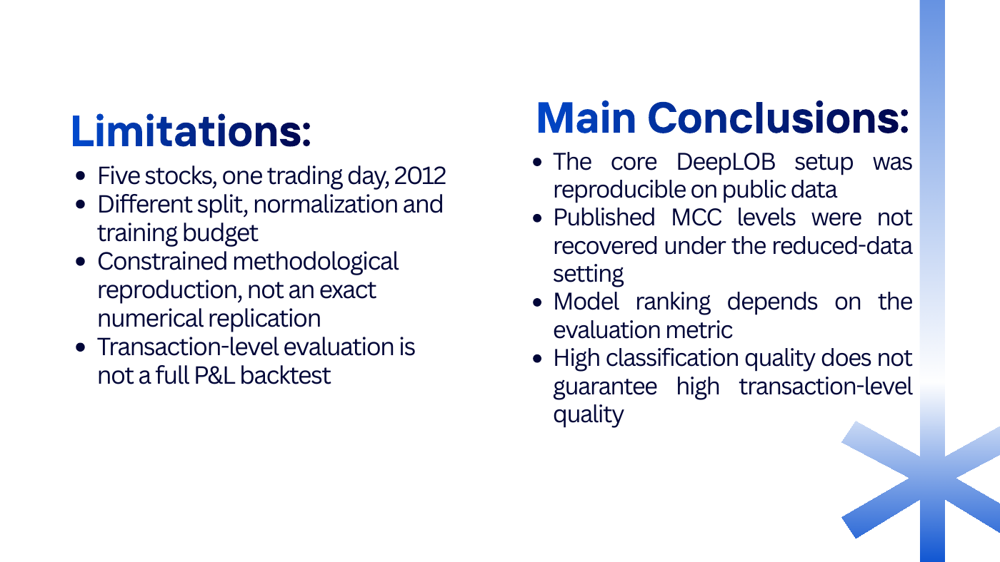](slides/slide-17.png)

## 18. thank    the original results

